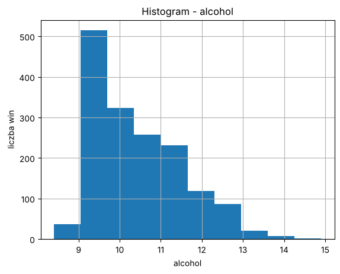
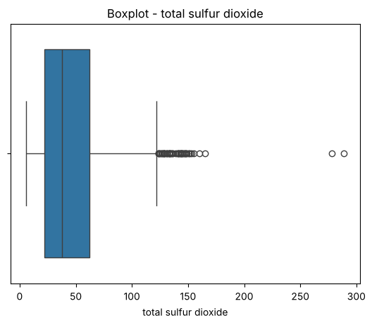
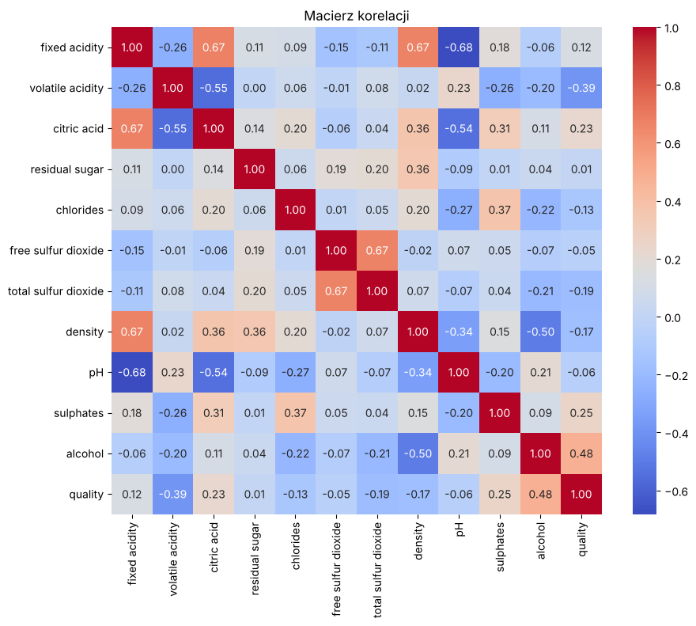
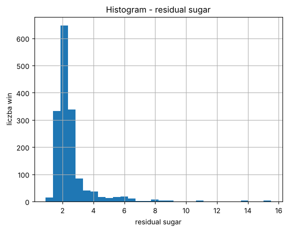
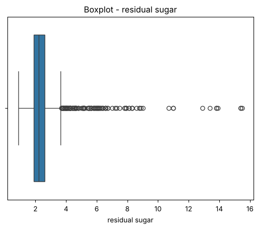
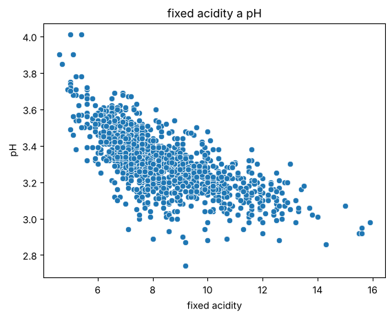

Lab 5

Jan Domański

Zbiór danych
Źródło: https://www.kaggle.com/datasets/uciml/red-wine-quality-cortez-et-al-2009
Nazwa: 
Red Wine Quality
Opis zbioru:
Zbiór ma 1599 wierszy i 12 kolumn. 
Każdy wiersz to jedno czerwone wino, a kolumny to wyniki badań chemicznych i ocena jakości w skali od 0 do 10. 
Wszystkie kolumny są liczbowe i nie ma w nim danych osobowych. 

Wnioski z EDA:
1. Rozkład zmiennych. Alkohol ma rozkład prawostronnie skośny, najwięcej win ma 9-10% alkoholu, średnia to 10.42, a mediana 10.2. Mocniej skośne są total sulfur dioxide i residual sugar. Na boxplocie total sulfur dioxide widać sporo wartości odstających, a dwa wina mają prawie 280-290, czyli dużo więcej niż reszta.

2. Braki danych. Według df.info() i df.isnull().sum() w żadnej kolumnie nie ma braków, każda ma 1599 wartości. Zbiór jest więc kompletny i nie trzeba niczego uzupełniać. Wyszło za to, że 240 wierszy to duplikaty.

3. Korelacje. Najsilniejsze zależności to fixed acidity z pH (-0,68), fixed acidity z citric acid (0,67), fixed acidity z density (0,67) oraz free sulfur dioxide z total sulfur dioxide (0,67). Z jakością najmocniej wiąże się alkohol (0,48), a ujemnie volatile acidity (-0,39), czyli lepiej oceniane wina mają zwykle więcej alkoholu i mniej kwasu octowego.

Wykresy:

Histogram - alcohol

Boxplot - total sulfur dioxide

Macierz korelacji

Zadanie 1:
Wybrałem residual sugar (cukier resztkowy). Rozkład jest mocno prawostronnie skośny, większość win ma 1,5-3 g/l cukru, a średnia (2,54) jest wyższa od mediany (2,2) przez kilka bardzo słodkich win (maksimum 15,5). Na boxplocie jest około 155 wartości odstających, wszystkie po prawej stronie.

Zadanie 2:
Procent braków policzyłem przez (df.isnull().mean()*100).round(1) i we wszystkich kolumnach wyszło 0,0%. Nie ma więc kolumny z największym odsetkiem braków i nie trzeba nic usuwać ani uzupełniać. Zbiór jest pewnie kompletny dlatego, że to pomiary laboratoryjne, które autorzy wcześniej przygotowali. Jedyne, co warto zapamiętać na kolejne zajęcia, to 240 zduplikowanych wierszy.

Zadanie 3:
Najsilniejsza korelacja na heatmapie to fixed acidity i pH, -0,68. Zależność jest ujemna i dość silna, im więcej kwasów, tym niższe pH, co dobrze widać na wykresie rozrzutu. Wysoka korelacja nie oznacza jednak, że jedna zmienna powoduje drugą, bo pokazuje tylko, że zmienne zmieniają się razem. Przyczyną może być trzecia zmienna albo przypadek. Tutaj akurat z chemii wiadomo, że kwasy obniżają pH, ale tego nie da się stwierdzić z samej korelacji.

