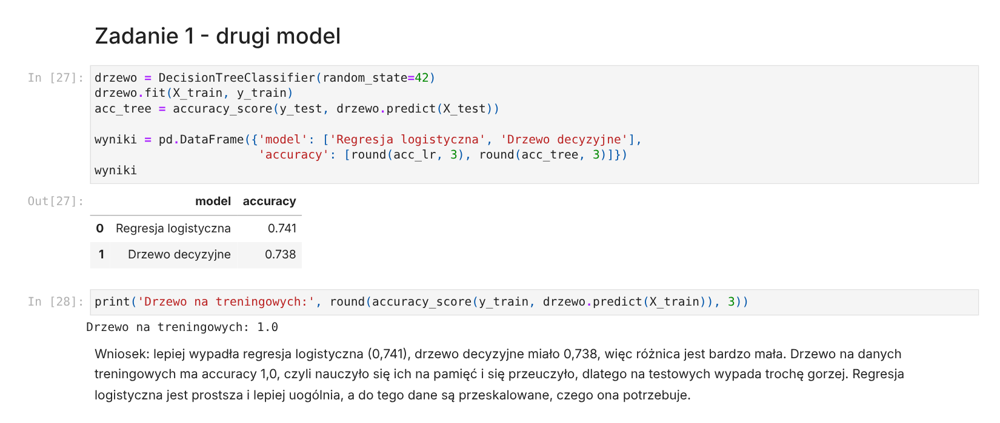
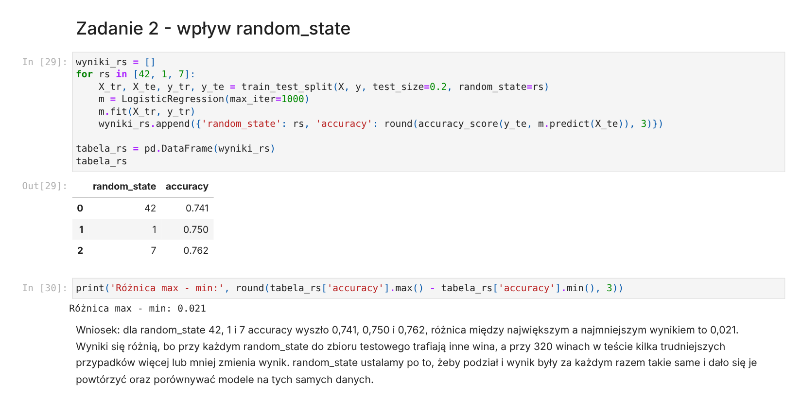
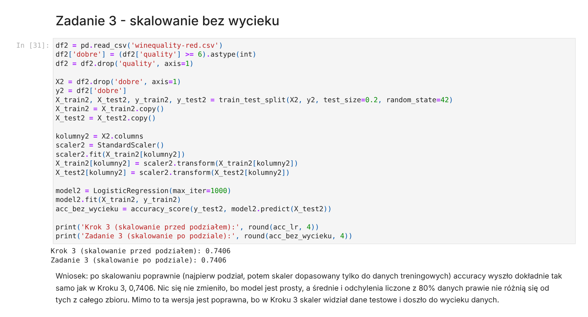

Lab 6

Jan Domański

Zbiór danych

Nazwa: Red Wine Quality (ten sam co na Lab 5)

Źródło: https://www.kaggle.com/datasets/uciml/red-wine-quality-cortez-et-al-2009

Notatnik lab06_model.ipynb to kopia notatnika z Lab 5, do której dopisałem kroki z tego laboratorium. Plik z danymi nie jest wgrany do repozytorium.

Zmienna docelowa: kolumna quality to ocena wina od 3 do 8, więc zamieniłem ją na kategorię 0/1. Nowa kolumna dobre ma wartość 1, gdy ocena jest 6 lub wyższa (855 win), a 0, gdy ocena to 3-5 (744 wina). Nie wziąłem progu powyżej mediany (czyli > 6), bo wtedy dobrych win byłoby tylko około 14% i accuracy byłaby myląca. Kolumnę quality usunąłem, bo inaczej model znałby odpowiedź.

Preprocessing

Braki danych: w zbiorze nie ma braków (df.isnull().sum().sum() daje 0, to samo wyszło na Lab 5), więc nie trzeba było niczego uzupełniać średnią ani usuwać wierszy.

Kodowanie: wszystkie cechy są liczbowe, nie ma kolumn kategorycznych, więc get_dummies nie był potrzebny. Zmiennej docelowej nie kodowałem.

Skalowanie: wszystkie 11 cech przeskalowałem StandardScalerem, po skalowaniu każda ma średnią 0 i odchylenie 1. Było to potrzebne, bo cechy mają bardzo różne skale, np. density to około 0,99, a total sulfur dioxide dochodzi do 289. Zmiennej docelowej nie skalowałem.

Podział: train_test_split z test_size=0.2 i random_state=42, wyszło 1279 win w zbiorze treningowym i 320 w testowym.

Wybór modelu i wynik

Wybrałem regresję logistyczną (LogisticRegression(max_iter=1000)). Mam problem klasyfikacji na dwie klasy, wszystkie cechy są liczbowe i przeskalowane, a regresja logistyczna jest prosta, szybka i mniej się przeucza niż drzewo decyzyjne. Model zapisałem do pliku model.pkl przez joblib.

Accuracy na zbiorze testowym: 0,741 (dokładnie 0,7406), czyli model dobrze klasyfikuje około 74% win.

Zadanie 1 - drugi model

| Model | Accuracy |
|---|---|
| Regresja logistyczna | 0,741 |
| Drzewo decyzyjne | 0,738 |

Lepiej wypadła regresja logistyczna, chociaż różnica jest bardzo mała. Drzewo decyzyjne na danych treningowych ma accuracy 1,0, czyli nauczyło się ich na pamięć i się przeuczyło, dlatego na testowych wypada trochę gorzej. Regresja logistyczna jest prostsza i lepiej uogólnia.

Zadanie 2 - wpływ random_state

| random_state | Accuracy |
|---|---|
| 42 | 0,741 |
| 1 | 0,750 |
| 7 | 0,762 |

Różnica między największym a najmniejszym wynikiem to 0,021. Wyniki się różnią, bo przy każdym random_state do zbioru testowego trafiają inne wina, a przy 320 winach w teście kilka trudniejszych przypadków więcej lub mniej zmienia wynik. random_state ustalamy po to, żeby podział i wynik dało się powtórzyć i żeby porównywać modele na tych samych danych.

Zadanie 3 - skalowanie bez wycieku

Wczytałem dane od nowa, najpierw zrobiłem podział na train i test, potem dopasowałem skaler tylko do danych treningowych i przekształciłem nim oba zbiory. Accuracy wyszło 0,7406, czyli dokładnie tak samo jak w Kroku 3. Nic się nie zmieniło, bo model jest prosty, a średnie i odchylenia liczone z 80% danych prawie nie różnią się od tych z całego zbioru. Mimo to ta wersja jest poprawna, bo w Kroku 3 skaler widział też dane testowe i doszło do wycieku danych.

