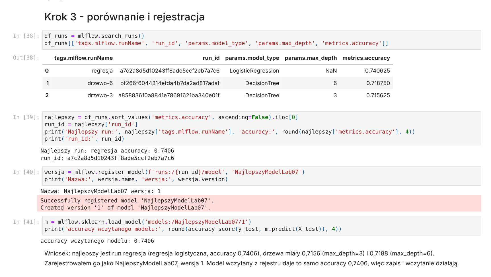
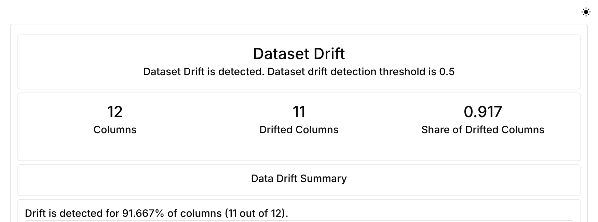
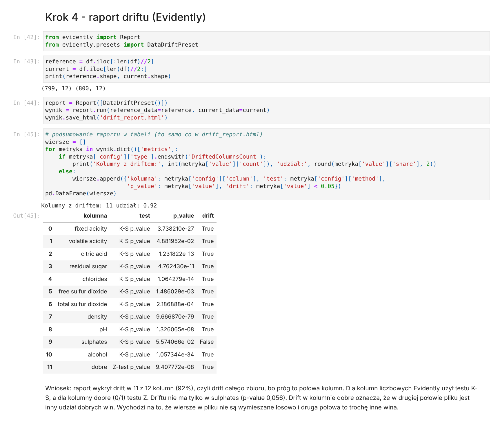
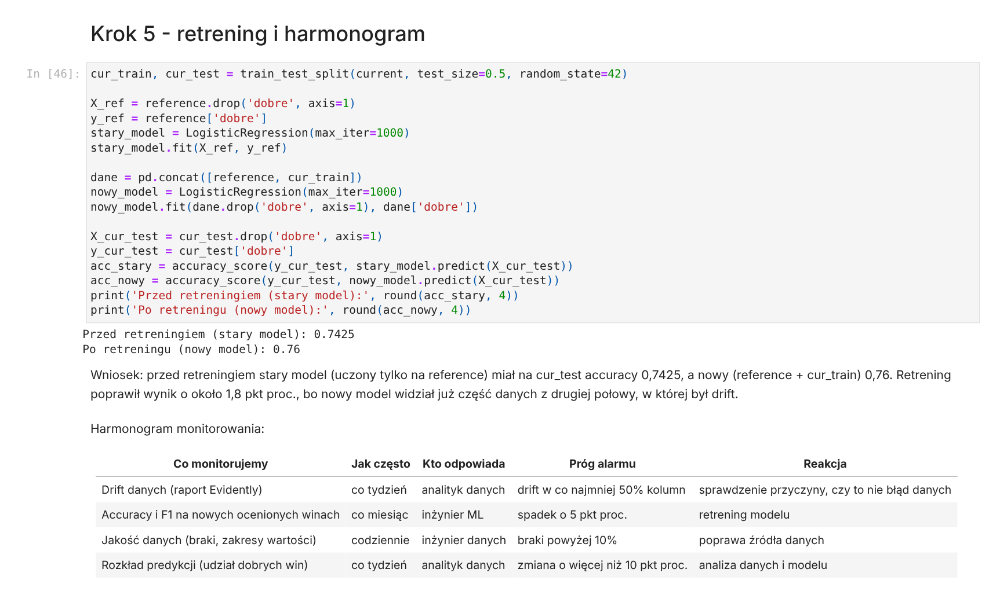
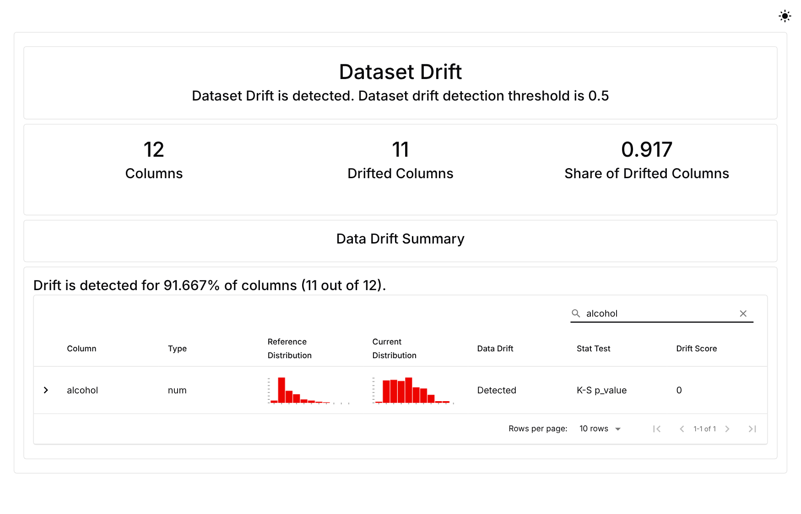
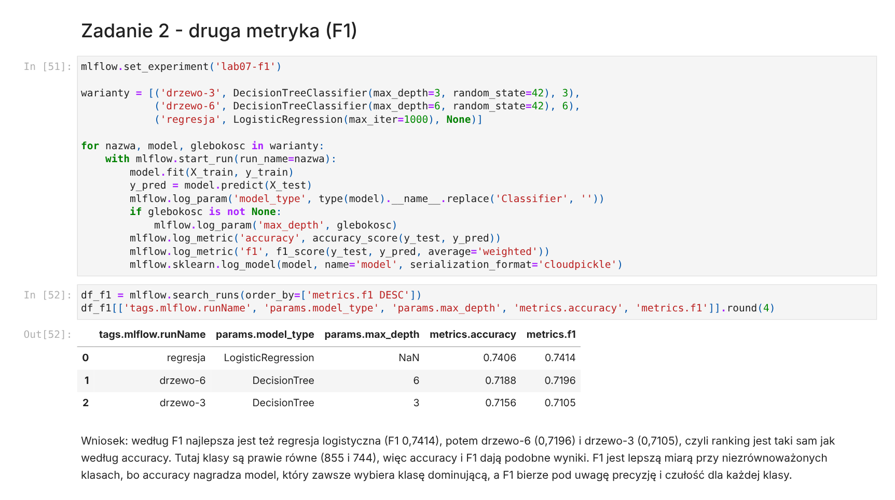

Lab 7

Jan Domański

Zbiór danych

Nazwa: Red Wine Quality

Źródło: https://www.kaggle.com/datasets/uciml/red-wine-quality-cortez-et-al-2009

Runy w MLflow

| Run | Model | Hiperparametry | Accuracy |
|---|---|---|---|
| drzewo-3 | DecisionTreeClassifier | max_depth=3, random_state=42 | 0,7156 |
| drzewo-6 | DecisionTreeClassifier | max_depth=6, random_state=42 | 0,7188 |
| regresja | LogisticRegression | max_iter=1000 | 0,7406 |

Najlepszy jest run regresja, bo ma najwyższe accuracy na tym samym zbiorze testowym. Drzewa wypadły gorzej, a głębsze drzewo jest tylko trochę lepsze od płytszego, czyli większa głębokość nie daje tu dużo. Regresja logistyczna ma też tę zaletę, że dane są przeskalowane, czego ona potrzebuje.

Rejestracja modelu

Nazwa: NajlepszyModelLab07

Wersja: 1

run_id: a7c2a8d5d10243ff8ade5ccf2eb7a7c6

Model zarejestrowałem przez mlflow.register_model z adresem runs:/<run_id>/model. Wczytałem go z rejestru i policzyłem accuracy na X_test, wyszło 0,7406, więc zapis i wczytanie działają.

Raport driftu

Dane podzieliłem na pół: reference to pierwsze 799 wierszy, current to pozostałe 800. Raport  wykrył drift w 11 z 12 kolumn (91,7%), więc wykryto drift całego zbioru, bo próg to połowa kolumn. Dla kolumn liczbowych użyto testu K-S, a dla kolumny dobre (0/1) testu Z. Drift mają wszystkie kolumny poza sulphates (p-value 0,056). Drift w kolumnie dobre oznacza, że w drugiej połowie pliku jest inny udział dobrych win. Wychodzi na to, że wiersze w pliku nie są wymieszane losowo i druga połowa to trochę inne wina.

Retrening

| Model | Dane do treningu | Accuracy na cur_test |
|---|---|---|
| Stary model (przed retreningiem) | reference | 0,7425 |
| Nowy model (po retreningu) | reference + cur_train | 0,7600 |

Oba modele to LogisticRegression(max_iter=1000) i oba oceniałem na tym samym zbiorze cur_test. Retrening poprawił wynik o około 1,8 pkt proc., bo nowy model widział już część danych z drugiej połowy, w której był drift.

Harmonogram monitorowania

| Co monitorujemy | Jak często | Kto odpowiada | Próg alarmu | Reakcja |
|---|---|---|---|---|
| Drift danych (raport Evidently) | co tydzień | analityk danych | drift w co najmniej 50% kolumn | sprawdzenie przyczyny, czy to nie błąd danych |
| Accuracy i F1 na nowych ocenionych winach | co miesiąc | inżynier ML | spadek o 5 pkt proc. | retrening modelu |
| Jakość danych (braki, zakresy wartości) | codziennie | inżynier danych | braki powyżej 10% | poprawa źródła danych |
| Rozkład predykcji (udział dobrych win) | co tydzień | analityk danych | zmiana o więcej niż 10 pkt proc. | analiza danych i modelu |

Zadanie 1 - symulacja driftu

Do kolumny alcohol w danych aktualnych dodałem 1 (kolumna jest przeskalowana, więc to przesunięcie o jedno odchylenie standardowe). Alcohol miała drift już wcześniej, ale po zmianie p-value w teście K-S spadło z około 1e-34 do około 2e-173, czyli drift jest dużo silniejszy. Drift wykrył test K-S. Accuracy starego modelu z Kroku 5 spadło z 0,7525 na current do 0,6913 na current_drift, czyli o około 6 pkt proc., bo model dostał wartości alkoholu, jakich nie widział przy treningu.

Zadanie 2 - druga metryka

| Run | Accuracy | F1 (weighted) |
|---|---|---|
| regresja | 0,7406 | 0,7414 |
| drzewo-6 | 0,7188 | 0,7196 |
| drzewo-3 | 0,7156 | 0,7105 |

Według F1 najlepsza jest też regresja logistyczna, więc ranking jest taki sam jak według accuracy. U mnie klasy są prawie równe (855 i 744), dlatego accuracy i F1 dają podobne wyniki. F1 jest lepszą miarą przy niezrównoważonych klasach, bo accuracy nagradza model, który zawsze wybiera klasę dominującą, a F1 bierze pod uwagę precyzję i czułość dla każdej klasy.

